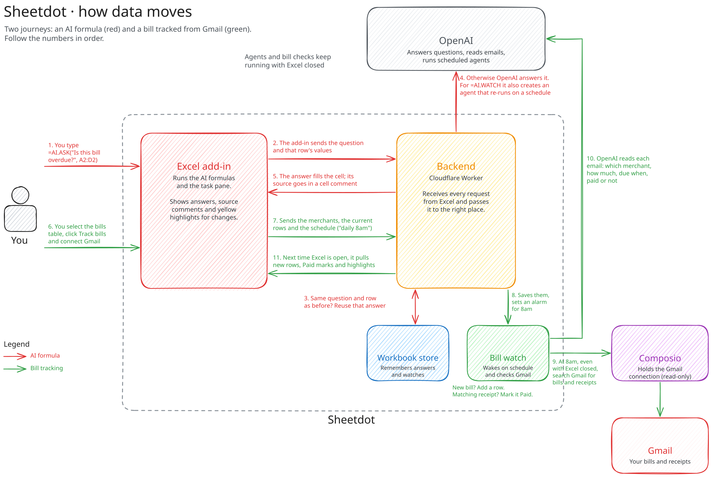

# Sheetdot

**A spreadsheet is the control plane for your personal agents.** You write AI formulas in Excel cells, and Sheetdot answers them, re-checks them on a schedule and keeps your tables up to date from Gmail, even while Excel is closed. There is no chat window: the sheet *is* the instruction.



Follow the numbers: the red path is an AI formula and the green path is a bill tracked from Gmail. The editable source is [docs/sheetdot-data-flow.excalidraw](docs/sheetdot-data-flow.excalidraw).

## Three examples

### 1. Track household bills from Gmail

You have a **Family Bills** table with *Merchant*, *Amount due* and *Due date*. Select it, click **Track bills** in the Sheetdot task pane, connect Gmail (read-only) and choose **daily 8am**.

- A December BESCOM bill lands in your inbox. At 8am, with Excel closed, Sheetdot reads it and adds a row: `BESCOM · ₹1,842 · due 12 Dec`.
- Two days later the payment receipt arrives. The same row turns **Paid**.
- When you next open Excel, both changes are highlighted in yellow, and each cell's comment links to the email it came from.

### 2. Ask a question of every row

On a **Find a Flat** table, type this in a new column and fill it down:

```
=AI.ASK("Does this listing allow pets?", A2:D2)
```

Each row gets its own answer, with the source in a purple comment. Use `AI.CHECK` when you want TRUE/FALSE that Excel's conditional formatting can colour:

```
=AI.CHECK("Rent is under ₹35,000 and it has 2+ bedrooms", A2:D2)
```

Select the table and Sheetdot also suggests columns in grey to the right, such as **Rent per bedroom**. Tick one to add it as a real column.

### 3. A standing order that re-runs on its own

```
=AI.WATCH("Will it rain on Saturday at this venue?", A2:C2, "daily 8am")
```

The formula creates an OpenAI-hosted agent that re-checks every morning. The **⏰ Automations** sheet lists it; edit its *Schedule* cell to change when it runs, or delete the row to stop it.

## The formulas

| Formula | What you get |
|---|---|
| `=AI.ASK(question, row)` | One value per row |
| `=AI.CHECK(condition, row)` | TRUE or FALSE |
| `=AI.LIST(request, n)` | A new table of up to *n* rows, spilled into the sheet |
| `=AI.WATCH(question, row, schedule)` | `AI.ASK`, re-run on a schedule like `"daily 8am"` or `"every 1 min"` |

Preferences you write on the **🙋 About me** sheet are given to every answer.

## Run it yourself

See [AGENTS.md](AGENTS.md) for setup from scratch: keys, local development, sideloading into Excel for the web, and deploying. The product plan and decisions are in [PLAN.md](PLAN.md).
